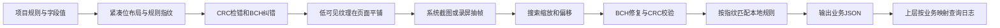

# 诊断水印：算法参考与业务接入

目标是让测试人员继续使用系统截图、系统录屏，而图片能携带可校验的诊断字段。客户端在页面合成中铺一层非常淡的纹理；解码器读取纹理，恢复紧凑数据，最后按业务规则转成 JSON。JSON 的字段名字不逐字写进图片。

本文对应仓库内 GHCV8 参考核心；GHCV6/7 仅保留历史解码兼容。它不是任意水印算法的通用解释器，也不承诺所有压缩、截图和页面都能恢复。

## 1. 用一个类比理解链路

规则像“表单模板”，规则指纹像“模板编号”，业务数据是“填好的答案”。BCH 像附带多份互相校对的提示，少量字迹损坏后仍有机会修复；CRC 像最后的核对码，修复后必须再次对得上才能使用。纹理重复像在整张纸上反复盖同一份信息，但不能把画出的每一个框都称为独立验证通过的水印。



图片只告诉解码器模板编号，不包含完整模板；独立分享时需要“图片＋匹配规则＋Skill”。规则和图片在本地处理，不需要服务器规则中心。

## 2. 先定义规则，不要手写两份布局

参考 [examples/watermark.schema.json](../examples/watermark.schema.json)，字段可叫 `accountId`、`tenantId` 或其他业务原名，不要求 `userId` / `gameId`。`projectKey` 必须是稳定标识，版本变化保留历史文件。详细类型、范围及长度要求见 [schema.md](schema.md)。

```js
const schema = require('../scripts/core/schema.js');
const codec = require('../scripts/core/codec.js');
const compiled = schema.compile(rule);
const message = schema.encode(rule, payload); // 27字节，仅211个有效位
const codeword = codec.bchEncode(message);    // 64字节，512位
const tile = codec.makeTile(message);        // 544×512×4，预乘透明度RGBA
```

真实代码路径以调用者位置为准；可直接运行 [encode-demo.cjs](../examples/encode-demo.cjs)。不要把 `codeword` 再传入 `makeTile`，它接收的是消息并自行做 BCH 编码。

### 指纹如何计算

`schema.compile` 对规则补齐默认值，例如整数的 min/max、布尔位数、字符串编码；对象键排序，字段数组顺序保留，再对规范 JSON 的 UTF-8 字节计算 SHA-256。其十六进制前16位就是64位规则指纹。不要直接对原文件文本做哈希：缩进和对象键顺序不应改变指纹，字段数组顺序会改变它。

指纹仅用于匹配格式，不是数字签名，不能证明字段来自可信用户或可信客户端。

## 3. GHCV8 消息格式

| 位区间（含端点） | 长度 | 内容 |
|---|---:|---|
| 0–3 | 4 | 版本数值8 |
| 4–67 | 64 | 规则指纹，作为整数写入 |
| 68–186 | 119 | 按规则字段顺序写业务数据，未使用部分补0 |
| 187–210 | 24 | 前187位的CRC24 |

每个数值低位先写，字节内也是低位在前。211位装入27字节，最后一字节的高5位必须为0。跨语言实现不能用十进制 JSON 字符串或网络字节序替代此位布局。

- 整数按位宽写入；有符号数使用该位宽的二进制补码。超过53位的账号在 JS 输入／输出使用十进制字符串或 BigInt，避免 Number 精度损失。
- 布尔固定1位。枚举写入 `values` 中的下标，顺序属于协议的一部分。
- 时间写 `(UTC秒 - epoch) / stepSeconds`，必须整除并在位宽范围内。以30秒为步长时，客户端先向下归入该时间片，不能把任意当前秒直接传入。30秒只是时间精度与刷新频率选择，不是视频帧率。
- string / bytes 写长度，再写固定最大字节数的内容，剩余字节补0；长度位数为 `ceil(log2(maxBytes+1))`，字符串按UTF-8字节计算，bytes按hex解释。
- 业务合计最多119位。例：账号63位＋业务16位＋时间26位＝105位，余14位补0。规则超限必须报错，不能静默截断或哈希替代字段。

CRC 初始化 `0xb704ce`，多项式 `0x864cfb`。按位数组顺序更新，取24位，无额外末尾异或。优先复用核心实现和测试向量，不替换为一个默认参数不同的“CRC24库”。

## 4. 纠错与纹理

### BCH

参考核心实现 BCH(511,211,t=40)，GF(2^9) 的本原多项式为 `0x211`，使用代码内固定生成多项式。300个纠错位在码字低位，211个消息位在后；再附一位总体偶校验，形成512位。不能只凭同名BCH参数就认为某个第三方库位序相同；需要逐字节比较码字。

恢复后需重新编码核对、通过CRC、业务范围和补零检查，并满足解码器的有效观测门槛。任一失败只返回未识别或具体错误，不输出残缺账号。CRC存在有限碰撞可能，也不是防篡改认证。

### 平铺纹理

参考纹理544×512 **物理像素**，共64行、17列，每格32×8像素。前16列放交织后的数据，第17列提供同步参考；512位码字在数据格中各映射两次，并使用固定哈希极性打散。映射、同步信号和正弦色度波均必须与 `codec.js` 完全相同，不能改用随机噪点或缩放后的普通图片替代。

当前核心输出alpha=4/255的预乘RGBA像素，RGB已经乘过透明度：不要再次乘alpha。用预乘纹理路径可直接合成；使用Canvas ImageData等非预乘接口时，需先还原RGB再让渲染器预乘，避免纹理弱到消失。不同平台要核对色彩空间、alpha格式和最终截图像素，而不是只确认视图存在。

Android / iOS / Web / 小程序可能用不同的逻辑单位。设备scale为3时，544物理像素相当于约181.33逻辑单位；平铺周期不能直接当成544dp或544pt。窗口变大时重复已有像素，不拉伸纹理周期。

## 5. 业务接入步骤

1. 定义项目规则及跨端测试向量，所有端使用同一指纹、位布局和字段含义。原生移植用 `messageHex`、`codewordHex`、`textureSha256` 校验，不只对比最终账号。
2. 从业务状态读取当前账号等字段；注销立即清旧纹理，不让旧异步任务回写。子业务字段由业务自己定义，不自动当作日志系统应用ID。
3. 编码和生成纹理在后台进行；账号、业务、时间片变化时更新缓存。不逐帧计算，不读回整个屏幕。
4. 在业务窗口合成一个不接收触摸的覆盖层，处理弹窗、窗口切换、旋转、物理比例变化；后台暂停，回前台刷新。系统键盘窗口不应被错误覆盖，不抢键盘、key window或无障碍焦点。
5. 用明确的内部包标记隔离，不用当前网络环境替代包类型。iOS可用发布宏做编译隔离，Android用内部包入口及实现保护；其他业务使用其既有包标记。外发包不创建水印层、计时器或编码任务。
6. 用系统截图和系统录屏保存原图／原分辨率帧进行解码，再测试裁剪、标注、缩放、JPEG、聊天软件／缺陷平台的实际上传下载。录屏必须逐帧独立校验，不靠多帧猜出账号。
7. 上层分析另外配置 `watermark.analysis.json` 的身份和时间映射；通用解码器不自动请求日志。规则更新须保留历史文件并同步所有解码镜像。

解码器会搜索常见比例及未知比例、相位和偏移。比例搜索是在寻找缩放后格子的宽度，并不是把图片裁成二分之一或三分之二。裁剪和标注会减少可用观测，压缩可能抹平低强度色度信号；“截图面积很大”不保证可识别。不要通过调低CRC或有效观测门槛包装成功。

## 6. 可运行例子和验收记录

```sh
node skills/watermark-decode/examples/encode-demo.cjs /tmp/watermark-demo
watermark-decode generate-rules --source /tmp/watermark-demo/vectors.json \
  --output /tmp/watermark-demo/restored.schema.json
watermark-decode decode-image /tmp/watermark-demo/sample.png \
  --rules /tmp/watermark-demo/restored.schema.json
```

例子生成原始预乘RGBA纹理及合成截图；PNG打包用到的CRC32只用于PNG文件结构，与载荷CRC24无关。业务方应记录源码向量、构建隔离、系统截图、转码和实际平台上传下载各层验证，不能把示例跑通当作真机验收。

其他项目使用不同纠错、纹理或位布局，需要新增受测试的协议适配器，而非仅导入一份字段规则。GHCV8业务字段可以变化，但协议骨架必须保持一致。

## 维护与许可

编解码核心统一跟随 Web 检查器上游，本仓库维护独立 Skill。更新核心需核对镜像哈希，并联动所有实际使用的客户端和自动分析工具。既有第三方许可随核心保留，见 [LICENSE.upstream](../scripts/core/LICENSE.upstream)。
